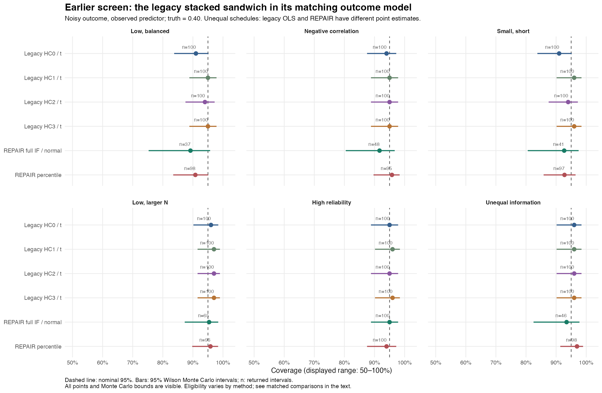
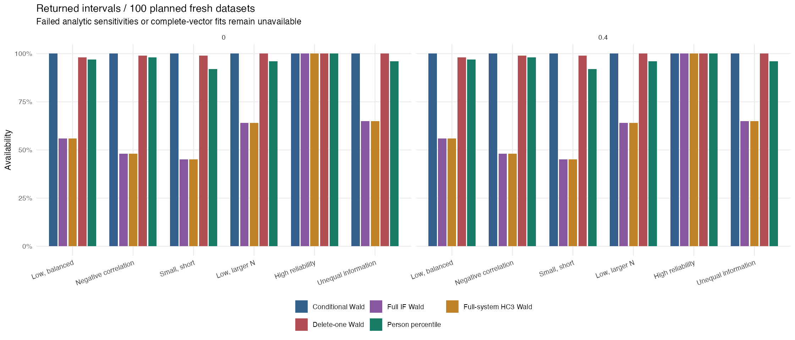
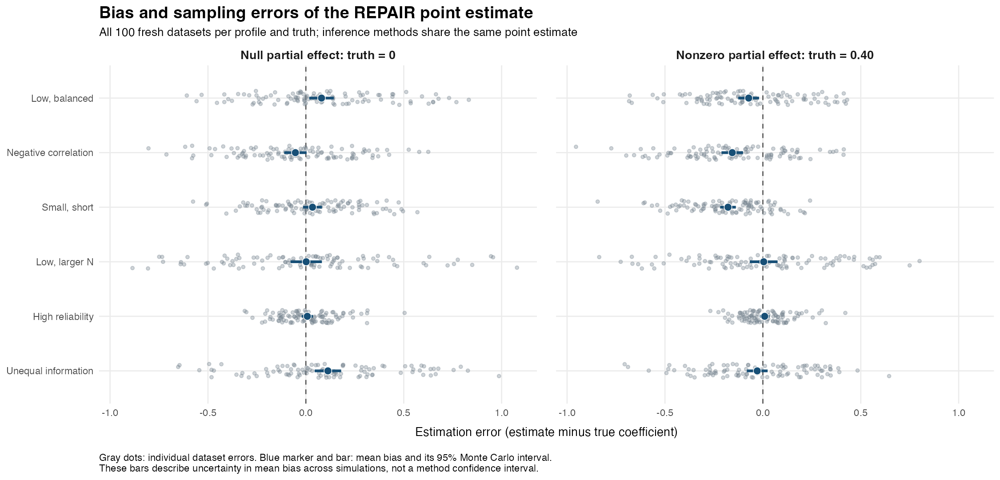
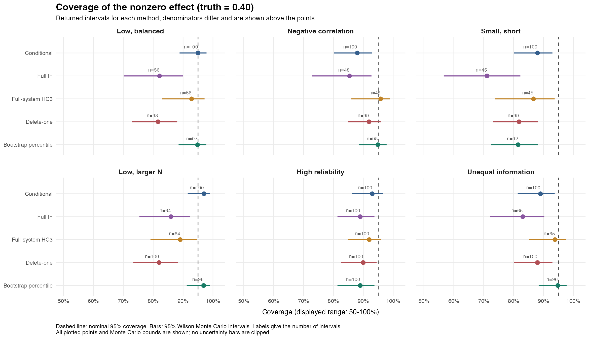
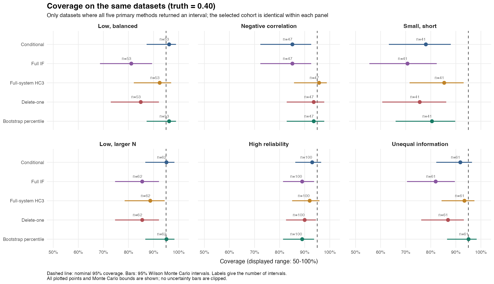
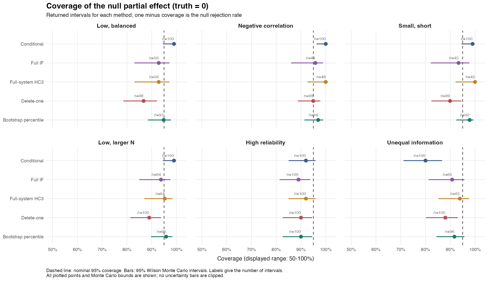
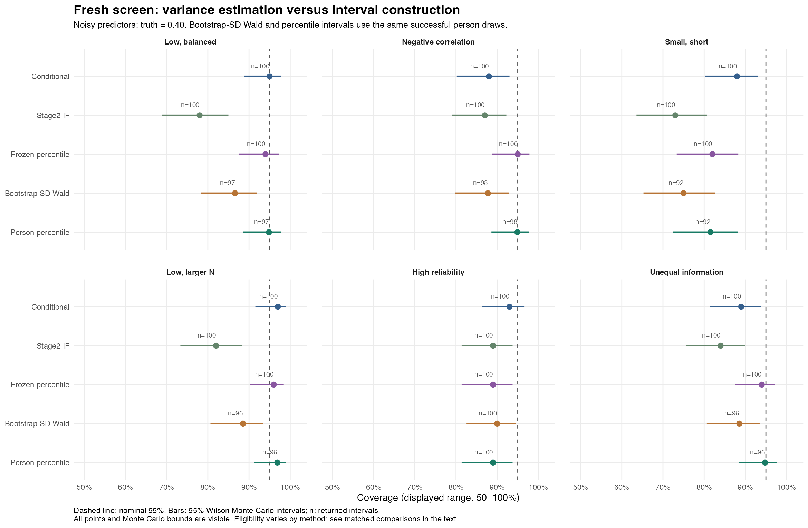
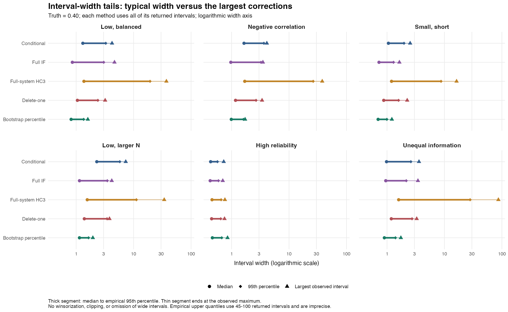
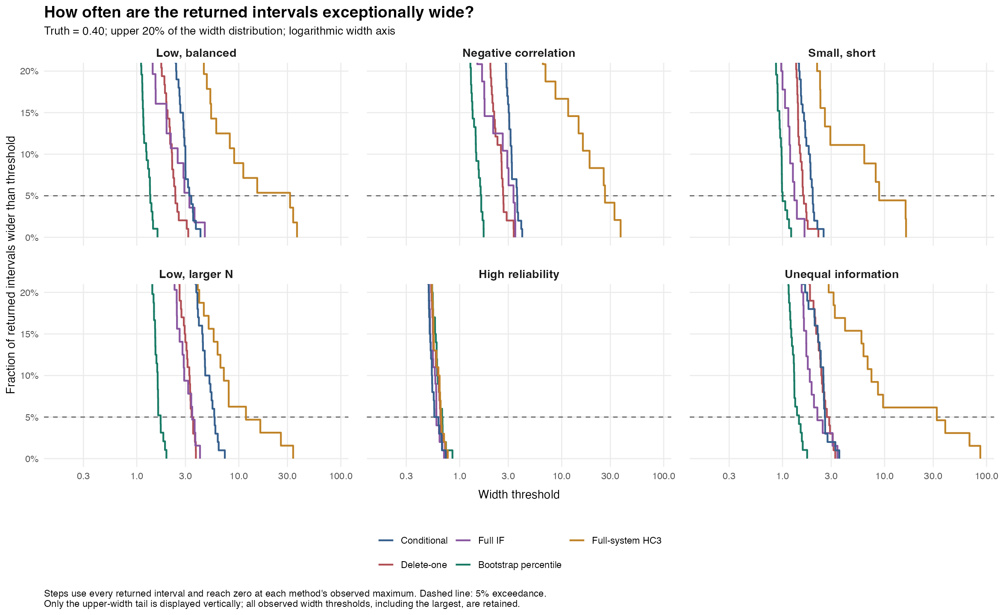
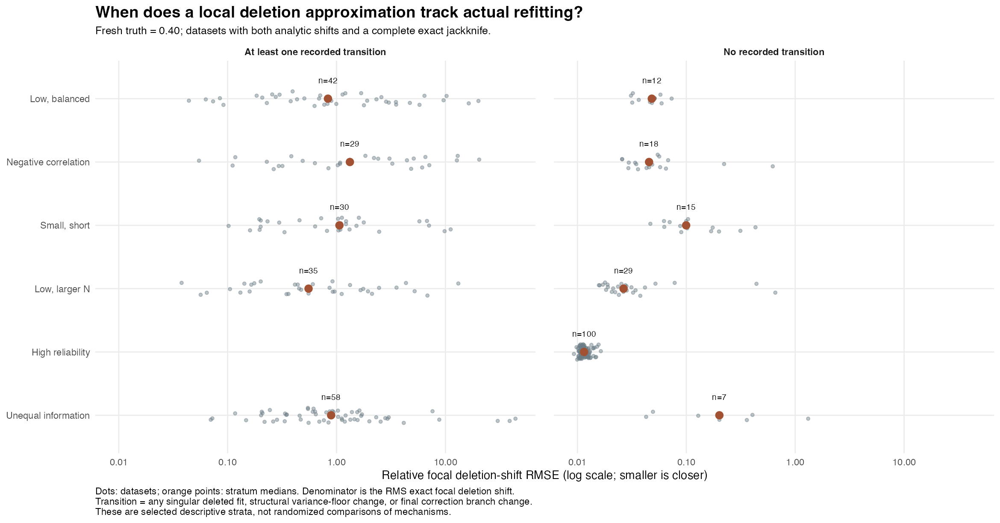

```{r}
#| label: setup
source("repair-uncertainty-methods/figures.R")
knitr::opts_chunk$set(out.width = "100%", fig.align = "center")
pct <- function(x) sprintf("%.1f%%", 100 * x)
```

## Purpose and main conclusions

REPAIR combines likelihood-only person scores from a fitted measurement model with a modified method-of-moments (M-MOM) structural regression. The ordinary covariance calculation accounts for the scores' additive sampling error, **conditional on the fitted measurement quantities**. Our subsequent work asks whether propagating their estimation uncertainty, correcting leverage, or using actual person refits improves finite-sample inference.

This report describes the implemented estimators and experimental comparators as of 31 October 2026. It synthesizes the [robust-refitting study](robust-refit-simulation/README.md), [influence-function study](influence-simulation/README.md), and [fresh leverage/delete-one study](leverage-simulation/README.md). It uses their retained outputs; rendering does not generate new data or fit measurement models. The formulas describe the current package implementation, with explicit distinctions from historical research code and proposals that remain unimplemented.

The main findings are:

1. **Reliable refitting was necessary to make bootstrap inference available.** Deterministic, likelihood-checked optimizer retries recovered almost all recorded computational failures without relaxing the convergence policy.
2. **Full cross-stage covariance is an important correction to the uncertainty calculation, but is insufficient for coverage.** The full influence sandwich differentiates the actual estimator, including estimated weights and moment corrections. Its local normal approximation still under-covers in several weak-information settings and is unavailable at singular measurement fits.
3. **Leverage correction improves selected-case coverage at a substantial cost in width and tail instability.** Exact delete-one refitting is useful diagnostically, but its symmetric Wald intervals also under-cover. Neither changes the original point estimate or removes its bias.
4. **Person percentile intervals are often more useful in the difficult predictor settings we tested, but are not a general solution.** They still under-cover in small, short panels. Frozen-measurement resampling performs similarly in several settings, so the observed bootstrap advantage cannot be attributed entirely to refitting measurement parameters.

::: {.callout-note title="What these studies establish"}
These are exploratory screens with 100 outer datasets per profile and truth. The robust and influence studies reuse an earlier set of 600 measurement datasets. The fresh study uses another 600 distinct datasets. Paired null/nonzero outcomes share measurement data, and the reused screens are not independent replications. Coverage must be read together with its denominator, Monte Carlo uncertainty, point bias, interval width, and the probability of returning an interval.
:::

## The estimation problem and the sources of uncertainty

### Measurement model and likelihood-only scores

For independent target people $i=1,\ldots,N$, write the Gaussian repeated-measures model as

$$
r_i=X_i\beta+Z_i\xi_i+W_i u_i+\epsilon_i,
\qquad
\operatorname{Var}(\xi_i)=G,\quad
\operatorname{Var}(u_i)=D,\quad
\operatorname{Var}(\epsilon_i)=R_i.
$$ {#eq-measurement}

The target effect is $\xi_i$, such as a person's random intercept and slope. The nuisance effect $u_i$ may represent days nested within that person. In the supported setting, these blocks are independent across people and the target and nuisance covariance terms are separable. Define

$$
C_i=R_i+W_iDW_i',\qquad V_i=C_i+Z_iGZ_i'.
$$

The likelihood-only score and its conditional sampling-error covariance are

$$
h_i(\psi)=L_i(r_i-X_i\beta),\quad
L_i=(Z_i'C_i^{-1}Z_i)^{-1}Z_i'C_i^{-1},\quad
\Omega_i(\psi)=(Z_i'C_i^{-1}Z_i)^{-1}.
$$ {#eq-scores}

Here $\psi$ collects the estimated measurement parameters. With those parameters fixed at their population values, $h_i=\xi_i+e_i$, with conditional mean-zero score error and covariance $\Omega_i$. In practice we use $\widehat\psi$, estimated from all people.

The target prior covariance $G$ belongs in the marginal fitting likelihood $V_i$, but **is excluded from the scoring covariance $C_i$**. Contained nuisance covariance remains in $C_i$. A BLUP and its posterior covariance do not satisfy the same contract as $h_i$ and $\Omega_i$. The package's earlier scoring/inference correction established this distinction and reconciled the structural SE with the manuscript and independent simulation fixtures; later uncertainty methods build on that corrected baseline.

Shared nuisance effects, such as one occasion affecting several target people, induce cross-person score-error covariance. Current structural assembly/refitting rejects these cases. Resampling people cannot by itself make shared clusters independent. Separate measurement models also require a justified cross-model score-error covariance policy; the full analytic derivative adapter currently covers a single Gaussian `lmer` model.

### Structural model and the joint score-error matrix

Let the latent structural model be

$$
y_i^*=a_i^{*'}b+\zeta_i,\qquad
a_i^*=(1,x_i^{*'})',\qquad
\operatorname{Var}(\zeta_i)=\tau^2.
$$

The observed structural inputs $y_i,a_i$ can contain likelihood-only scores and error-free observed variables. Their joint additive error covariance, including zero entries for the intercept and observed variables, is

$$
E_i=\begin{pmatrix}\omega_{yy,i}&k_i'\\k_i&Q_i\end{pmatrix},
\qquad z_i=\begin{pmatrix}y_i\\a_i\end{pmatrix},\qquad M_i=z_i z_i'.
$$ {#eq-joint-error}

For example, random intercept and slope predictors from the same measurement model generally have correlated errors. Dropping the off-diagonal entries of $Q_i$, or the outcome–predictor error covariance $k_i$ when present, changes the estimator.

There are several distinct problems to address:

| Source | Example | Which methods address it? |
|---|---|---|
| Additive score sampling error at fixed measurement parameters | A short panel yields a noisy person slope | Ordinary M-MOM corrects moments and uses a model-based score-error covariance |
| Estimated measurement parameters and their cross-stage dependence | The same people determine $\widehat\sigma$, scores, error variances, and structural coefficients | Full sandwich, full bootstrap, and full delete-one refits |
| Estimated structural moments, weights, and corrections | Preliminary slopes determine feasible weights | Stage2/full influence and resampling recompute these quantities |
| Small-sample leverage | A person strongly affects a corrected moment inverse | Full-system leverage candidate; actual deletion diagnoses sensitivity |
| Bias, skewness, weak corrected moments, and branch transitions | A residual variance hits zero or a generalized-root correction changes branch | No tested SE formula guarantees a remedy; percentile resampling can represent some nonlinearity |

### The actual finite-sample M-MOM functional

The derivations must follow the estimator actually computed. Let $p$ include the structural intercept. For observed/error moment matrices $(M,E)$, let $\lambda(M,E)$ be the smallest finite real generalized determinant root of $\det(M-\lambda E)=0$. Singular error matrices can give infinite roots, which are not selected as finite roots. Under the minimum/custom regularization policy, the multiplier is

$$
c_N(\lambda;\alpha)=
\begin{cases}
\lambda-(1+\alpha)/N,&\lambda\text{ finite and }\lambda\leq1+1/N,\\
1-\alpha/N,&\text{otherwise}.
\end{cases}
$$ {#eq-correction}

The minimum policy uses $\alpha=(\text{number of predictors})+2=p+1$. Preliminary and final policies can differ. `correction = "none"` sets $c=1$: it disables regularization, **not measurement-error subtraction**. The zero-error case also uses $c=1$. Adaptive manuscript M-MOMS/`step_up` tuning is not implemented and was not used in these screens.

The preliminary coefficient is

$$
b_0=\left[\sum_i a_i a_i'-c_P\sum_i Q_i\right]^{-1}
     \left[\sum_i a_i y_i-c_P\sum_i k_i\right],
\quad c_P=c_N\!\left\{\lambda\!\left(\sum_i M_i,\sum_i E_i\right);\alpha_P\right\}.
$$ {#eq-preliminary}

Its composite score-error variance and residual are

$$
s_i(b_0)=\omega_{yy,i}-2b_0'k_i+b_0'Q_i b_0,
\qquad e_i^0=y_i-a_i'b_0.
$$

For $N>p$, the structural residual variance and inverse case-variance weights are

$$
\widehat\tau^2=
\begin{cases}
0,&\lambda_P<1\text{ and finite},\\
\max\!\left\{0,\dfrac{\sum_i(e_i^0)^2}{N-p}-\dfrac1N\sum_i s_i(b_0)\right\},&\text{otherwise},
\end{cases}
\qquad
w_i=\{\widehat\tau^2+s_i(b_0)\}^{-1}.
$$ {#eq-weights}

The code uses $\max(1,N-p)$ in the denominator if necessary. Materially negative composite error variance or nonpositive case variance is a failure, not a license to use an arbitrary ridge. Tiny negative composite values within numerical tolerance are clipped to zero.

Finally, with $c_F=c_N\{\lambda(\sum_i w_iM_i,\sum_i w_iE_i);\alpha_F\}$,

$$
A_F=\sum_i w_i(a_i a_i'-c_FQ_i),\quad
q_F=\sum_i w_i(a_i y_i-c_Fk_i),\quad
\widehat b=A_F^{-1}q_F.
$$ {#eq-final}

Thus $\widehat b$ depends on much more than a final regression: likelihood scores, their error covariances, two generalized-root corrections, a preliminary regression, a variance floor, feasible weights, and a corrected inverse. All of these data-dependent quantities must be included when differentiating or refitting the complete estimator.

## Ordinary conditional, model-based standard errors

Define $t_i=k_i-Q_i b_0$. The current package covariance is

$$
\widehat V_{\mathrm{conditional}}
=A_F^{-1}\left\{\sum_i w_i a_i a_i'
                  +\sum_i w_i^2t_it_i'\right\}A_F^{-T}.
$$ {#eq-conditional}

This matches the modified-moment convention in the manuscript appendix [@vig2026]. The manuscript writes the case variance as its weight quantity; this report writes its **inverse** as $w_i$. That change of notation explains why the second term has $w_i^2$. The modified final bread $A_F$, preliminary $b_0$, and squared inverse-variance factor are all material. Replacing the bread by the unmodified predictor cross-product changes the SE precisely in the weak-information cases where regularization matters.

A useful motivation is the unregularized, known-measurement-parameter Gaussian working model. Let $g_i=a_i(y_i-a_i'b)-t_i$, evaluated at the true $b$, with independent structural error and jointly normal score errors. Gaussian product moments give

$$
\operatorname{Var}(g_i)
=E(a_i a_i')\{\tau^2+s_i(b)\}+t_it_i'.
$$

Multiplying by inverse-variance weights gives the two meat terms in @eq-conditional. The package plugs in estimated quantities and uses the regularized final bread. This motivation does **not** prove an exact finite-sample variance formula for data-selected multipliers, floors, or estimated measurement parameters.

Ordinary intervals use $\widehat b_j\pm z_{.975}\sqrt{\widehat V_{jj}}$. This method is inexpensive and accounts for additive score error under its working assumptions. It does not propagate $\widehat\psi$, nor does its model-based meat equal the empirical full-pipeline influence covariance below. A larger conditional SE can sometimes produce coverage near 95% despite point bias; that is not evidence that all omitted uncertainty is negligible.

## Empirical person resampling and full refitting

### A common replay contract

`repair_refit()` is the foundation for the resampling methods. It first verifies that the declared recipe reproduces the stored analysis. A requested person draw carries the person's complete repeated-measures history and structural row. A repeated selection receives a fresh target ID; contained nuisance IDs are rekeyed consistently. The measurement model is optimized again, likelihood-only scores/error covariances are rebuilt, and the entire M-MOM fit is recalculated.

This is a random-person sampling pathway. It does not represent uncertainty conditional on the original realized people, and it does not resample individual occasions as though they were independent people. Sample-wide transformations depending on unselected rows require particular care and are outside the supported replay contract where they cannot be reproduced correctly.

### Full person cases bootstrap

Draw $I_1^{*(r)},\ldots,I_N^{*(r)}$ independently and uniformly from the $N$ people. The resulting frequencies satisfy

$$
f^{*(r)}\sim\operatorname{Multinomial}\{N;(1/N,\ldots,1/N)\},
\qquad
\widehat\psi^{*(r)}=\operatorname{fit}_{\mathrm{measurement}}(f^{*(r)}),
\qquad
\widehat b^{*(r)}=T(f^{*(r)},\widehat\psi^{*(r)}).
$$ {#eq-bootstrap}

Here $T$ denotes the full canonical structural point functional from @eq-preliminary–@eq-final, with original $N$ because each draw contains $N$ sampled people. If all $B$ requested coefficient vectors are usable,

$$
\bar b^*=B^{-1}\sum_r\widehat b^{*(r)},\qquad
\widehat V_{\mathrm{boot}}=(B-1)^{-1}\sum_r
(\widehat b^{*(r)}-\bar b^*)(\widehat b^{*(r)}-\bar b^*)'.
$$

The package's percentile interval is

$$
\left[\widehat Q_{.025}(b_j^*),\widehat Q_{.975}(b_j^*)\right],
$$ {#eq-percentile}

using R's type-7 quantiles. It may be asymmetric and need not be centered on the original estimate. The reported point estimate remains $\widehat b$; neither the bootstrap mean nor a bias-corrected estimate replaces it. Bootstrap covariance is not added to the conditional covariance, which would double-count overlapping uncertainty.

The fresh study also evaluated $\widehat b_j\pm1.96\,\operatorname{SD}(b_j^*)$, labeled **bootstrap-SD Wald**. This uses the same draws but a symmetric normal interval. It is not a bootstrap-*t* interval: no replicate-specific studentized pivot is constructed. Its worse coverage in several profiles helps separate distributional shape/location from variance estimation alone.

### Frozen-measurement cases bootstrap

The diagnostic comparator holds the original measurement fit and person scores/error matrices fixed:

$$
\widehat b_{\mathrm{frozen}}^{*(r)}=T(f^{*(r)},\widehat\psi).
$$

It resamples empirical person contributions and recomputes preliminary/final M-MOM moments, corrections, floors, and weights. It therefore does more than hold a final regression fixed, but does not propagate measurement-parameter estimation. It is a study comparator, not the public full-refitting bootstrap API.

Frozen versus full resampling on identical draws isolates the incremental effect of measurement refitting in this design. Their similarity does not establish that measurement fitting is irrelevant in other models. In particular, balanced outcome regressions have an exact focal cancellation described below.

### Unequal-information stratified resampling

The unequal profile contains fixed numbers of short and long panels. A study-only comparator resamples people independently within these schedule strata while holding each stratum count fixed. Its sampling distribution conditions on those counts; the ordinary person bootstrap lets their composition fluctuate. This distinction concerns the target sampling design, not a generic correction for heteroskedasticity. There is currently no public `strata` bootstrap argument.

### Failures, optimizer robustness, and inner Monte Carlo error

Default bootstrap inference requires **every requested complete coefficient vector** to be usable. A failed coefficient is not dropped just for the focal term. Attempts and reasons are retained; failed draws are not silently replaced. `allow_failed = TRUE` explicitly requests inference conditional on successful draws, which can be selection-biased and is not a calibration fix. Caller RNG state is isolated, and deterministic retries occur within a requested draw rather than sampling a new person vector.

The robust `lmer` recipe uses `nloptwrap` initialization, then `minqa` BOBYQA initialized from that solution. Cold/interior deterministic retries are bounded. A selected converged BOBYQA candidate must be within $10^{-6}$ deviance units of the best finite attempt. Convergence checks remain in force; singular-but-converged fits follow the existing refit policy and are recorded.

The controls include BOBYQA `rhobeg = .002`, `rhoend = 1e-8`, and `maxfun = 200000`. Explicit `nloptwrap` tolerances of `1e-8` already equaled the installed defaults; increasing its budget alone did not resolve the selected development failures. Both implementations use the BOBYQA algorithm family, so this is not evidence from three independent optimizer families. See the [optimizer clarification](robust-refit-simulation/protocol-clarification.md).

In the paired reused screen, unresolved requested measurement fits fell from 2,363/348,302 (0.678%) to 27/349,300 (0.0077%); 2,349 old failures were recovered. The distinct-request denominators differ, so recovery is also reported explicitly. Ordinary default interval availability rose from 121/600 to 584/600 measurement datasets. This is a computational improvement, not a different SE theory.

{#fig-robust}

The main screens use $B=499$; the public default is 1,999. More draws reduce inner quantile Monte Carlo error, not outer coverage uncertainty. Under a crude independent failure probability $q$ per draw, strict availability is approximately $(1-q)^B$, so increasing $B$ can expose additional failures. The fresh sensitivity study illustrates this: all 78 selected interval records were available at 499 draws, six were withheld at 1,999, and the 72 common intervals retained their coverage decisions. This subset is too small to establish coverage accuracy.

## The existing stacked sandwich comparator

### Its estimand and equations

The research function `stacked_sandwich_for_corrected_scores()` in `blup_unshrinking/R/stacked_sandwich_helpers.R` regresses a **recovered slope outcome** on an observed predictor. It is not the M-MOM errors-in-predictors estimator. For design $a_i=(1,x_i)'$, define

$$
g_i(\psi,b)=\begin{pmatrix}s_i(\psi)\\a_i\{h_i(\psi)-a_i'b\}\end{pmatrix},\quad
A=-\frac1N\sum_i\frac{\partial g_i}{\partial(\psi',b')}
=\begin{pmatrix}A_{11}&0\\A_{21}&A_{22}\end{pmatrix},
\quad B=\frac1N\sum_i g_i g_i'.
$$

The covariance is the structural block of $A^{-1}BA^{-T}/N$. The off-diagonal meat and $A_{21}$ propagate first-stage estimation and its covariance with the structural equations. The implemented Gaussian backend uses the observed score sensitivity; historical wording about an expected-information backend should not be read as a different executed estimator.

For a linear slope score with iid measurement residuals, common fixed-slope centering shifts every recovered slope by the same amount. A structural intercept absorbs that shift, so its derivative has no effect on the focal structural slope. With a balanced schedule, structural precision weights are also constant, and REPAIR's outcome-only model reduces to this OLS slope. This is an exact anchor for checking implementations; it is not evidence that cross-stage effects vanish with noisy predictors or unequal precision.

### Historical HC0–HC3 and critical values

The helper returns four variants:

| Variant | Executed change |
|---|---|
| HC0 | Unadjusted stacked meat |
| HC1 | Multiply HC0 covariance by $N/\max(N-p_\eta,1)$, with **all stacked parameters** counted |
| HC2 | Divide only the structural residual contribution by $\sqrt{1-h_{ii}}$ |
| HC3 | Divide only the structural residual contribution by $1-h_{ii}$ |

Here $h_{ii}=a_i'(\sum_j a_ja_j')^{-1}a_i$, capped at .999 by that historical helper. Measurement score rows are not leverage-adjusted; cross-stage meat changes because structural rows change. In the screen's random-intercept/slope model there are six measurement and two OLS coefficients, so the HC1 multiplier counts eight parameters. Legacy intervals use $t_{N-2,.975}$. These conventions are preserved as comparators, not attributed to the new full-system correction.

At unequal schedules, legacy unweighted OLS and precision-weighted REPAIR target the same population slope under this DGP but have different point estimates. It would be invalid to place the helper's OLS variance onto a noisy-predictor M-MOM estimate. The GPL research helper was sourced for comparison, not copied into the MIT package.

{#fig-legacy}

The balanced anchor passed 1,000 paired comparisons: maximum point discrepancy $5.55\times10^{-16}$, stage2/legacy HC0 variance discrepancy $6.09\times10^{-8}$. Legacy HC3/*t* nonzero-effect coverage was 95–97% across these outcome profiles, with 100 intervals per profile. This favorable result is limited to its matching outcome problem. It is not the result of applying that method to the harder two-noisy-predictor regression.

## Stage2 and full influence-function sandwiches

### Differentiate the complete structural functional

Let $T(f,\psi)$ be the actual finite-sample M-MOM point estimate for nonnegative frequencies summing to $N$. Along the centered person perturbation

$$
f_j(\epsilon;i)=1+\epsilon\{\mathbf1(j=i)-1/N\},
$$

the frozen-measurement structural influence is

$$
U_i=N\left.\frac{dT\{f(\epsilon;i),\widehat\psi\}}{d\epsilon}\right|_{0},
\qquad
\widehat V_{\mathrm{stage2}}=\frac1{N^2}\sum_i U_iU_i'.
$$ {#eq-stage2}

Every structural moment, preliminary coefficient, weight, and data-dependent multiplier updates. $N$, the declared correction policies, and custom $\alpha$ stay fixed. The package numerically centers the influence rows. This is an empirical structural covariance, unlike the conditional Gaussian working meat in @eq-conditional. It can therefore differ even before measurement-parameter propagation is added.

### Measurement influence with ML or REML

For Gaussian ML, person likelihood scores are additive. With $v_i=r_i-X_i\beta$ and $V_{ij}=\partial V_i/\partial\psi_j$, their fixed-effect and covariance coordinates are

$$
s_{\beta,i}=X_i'V_i^{-1}v_i,\qquad
s_{j,i}=\tfrac12\{v_i'V_i^{-1}V_{ij}V_i^{-1}v_i
-\operatorname{tr}(V_i^{-1}V_{ij})\}.
$$

For REML, the determinant depends on the entire sample and its frequency derivative must be included. A joint estimating representation is

$$
\ell_R(f,\psi)=\sum_i f_i\ell_i(\beta,V_i)
-\tfrac12\log|H(f)|+\tfrac{p_\beta}{2}\log(2\pi),
\qquad H(f)=\sum_i f_i X_i'V_i^{-1}X_i.
$$ {#eq-reml}

At the GLS solution for $\beta$, profiling this representation gives the restricted criterion. It is not a claim that REML is an additive iid likelihood. For covariance parameter $\psi_j$, put

$$
H_i=X_i'V_i^{-1}X_i,\quad
D_{ij}=X_i'V_i^{-1}\frac{\partial V_i}{\partial\psi_j}V_i^{-1}X_i,
\qquad D_j=\sum_i f_iD_{ij}.
$$

The determinant adds $\tfrac12\operatorname{tr}(H^{-1}D_j)$ to that covariance score. Its uncentered frequency derivative for person $i$ is

$$
\tfrac12\left\{\operatorname{tr}(H^{-1}D_{ij})
-\operatorname{tr}(H^{-1}H_iH^{-1}D_j)\right\}.
$$ {#eq-reml-frequency}

Omitting this term and evaluating ML scores at a REML fit does not differentiate the fitted estimator. Let $S=\partial\ell/\partial\psi$ denote the appropriate total measurement score, $s_i^*$ its centered person-frequency derivative, and

$$
A_\psi=-\frac1N\frac{\partial S}{\partial\psi'},\qquad
\operatorname{IF}_{\psi,i}=A_\psi^{-1}s_i^*.
$$

The adapter uses fixed effects, transformed native `lme4` covariance coordinates (log positive Cholesky diagonals, unconstrained off-diagonals), and log residual SD. Gaussian likelihood scores are analytic; sensitivity and structural derivatives use checked finite differences. This is an analytic influence construction implemented with numerical differentiation, not a fully symbolic formula or repeated native optimization.

### Cross-stage covariance is signed

Let $D_b=\partial T(\mathbf1,\psi)/\partial\psi'$. The chain rule gives

$$
I_i=U_i+D_b\operatorname{IF}_{\psi,i},\qquad
\widehat V_{\mathrm{full}}=\frac1{N^2}\sum_i I_iI_i'.
$$ {#eq-full-if}

Writing $P_i=D_b\operatorname{IF}_{\psi,i}$,

$$
\widehat V_{\mathrm{full}}
=\underbrace{N^{-2}\sum_iU_iU_i'}_{\text{structural}}
+\underbrace{N^{-2}\sum_iP_iP_i'}_{\text{measurement}}
+\underbrace{N^{-2}\sum_i(U_iP_i'+P_iU_i')}_{\text{signed cross-stage term}}.
$$ {#eq-cross-stage}

The cross term can reduce a particular variance. Adding only an independent positive first-stage variance is not equivalent. The conditional covariance is not added to this full covariance.

This is the same chain-rule principle as a correctly stacked two-stage estimating system. In the simpler block notation above, its structural influence is $A_{22}^{-1}\{g_{2i}-A_{21}A_{11}^{-1}s_{1i}\}$, and implicit differentiation gives $D_b=-A_{22}^{-1}A_{21}$. The new implementation's advance over the legacy comparator is the functional being differentiated: the complete regularized M-MOM estimator and the actual ML/REML measurement criterion, rather than an OLS recovered-outcome regression.

### Availability and interpretation

`repair_sandwich()` returns separate full and stage2 components while preserving the original estimate. It refuses full inference for singular original random-effect covariances, nonstationary fits, weak/indefinite measurement sensitivity, unstable derivatives, or branch-crossing perturbations that cannot be stabilized. Stage2 inference can remain available. A missing full result never silently becomes a stage2 or conditional result.

The current adapter supports one Gaussian `lmer`, aligned person cohorts, and contained nuisance effects; `nlme`, multiple-model derivatives, and shared effects are outside this analytic implementation. Normal HC0/Wald intervals are primary. Stable numerical derivatives on a local branch do not establish a regular sampling distribution near a variance boundary or moment-correction transition.

{#fig-earlier}

The earlier experiment returned full IF intervals for 1,351/2,400 structural analyses: 1,048 refusals were singular original fits and one was an unstable derivative. Stage2 was available for all 2,400. Full/stage2 focal variance ratios in the predictor arm ranged approximately .79–3.62; the full correction was not uniformly inflationary. Noisy-predictor nonzero-effect full IF coverage was 73–83% in the five difficult profiles, conditional on the 37–66 eligible datasets/profile, versus approximately 79–96% for the person bootstrap on 95–98 eligible datasets/profile. Matched comparisons are necessary to distinguish calibration from eligibility selection.

## Full-system leverage correction

### Why an ordinary HC multiplier is insufficient

Ordinary regression HC corrections compensate for residual shrinkage from fitting coefficients. A REPAIR person also affects the measurement fit, preliminary moments, moment-root corrections, the variance floor, and feasible weights. Applying a final-design $1/(1-h_{ii})$ factor alone does not describe this system. Classical HC and GEE small-sample corrections motivate a deletion-based extension [@mackinnon1985; @mancl2001], but do not supply a theorem for regularized M-MOM.

### An explicit augmented estimating representation

Define mean observed/error moments $M,E$, weighted mean moments $W,F$, and mean weight $a_w>0$. The parameter vector is

$$
\eta=\{\psi,\operatorname{vech}(M),\operatorname{vech}(E),
\operatorname{vech}(W),\operatorname{vech}(F),\log a_w,b\}.
$$

Only structurally allowed noisy entries of the symmetric error moments are free coordinates; known-zero intercept/observed-variable error entries are excluded. From $M,E$, reconstruct $b_0$, $c_P$, and $\widehat\tau^2$ by the same rules as before. In mean-moment notation, with $v=(1,-b_0')'$, the non-forced variance branch is $\max\{0,Nv'Mv/(N-p)-v'Ev\}$. Each reconstructed person error matrix determines $w_i$. The final $c_F$ is a function of $W,F$.

The structural person equations are

$$
\phi_i(\eta)=\begin{pmatrix}
\operatorname{vech}(M_i-M)\\
\operatorname{vech}(E_i-E)\\
\operatorname{vech}(w_iM_i-W)\\
\operatorname{vech}(w_iE_i-F)\\
w_i/a_w-1\\
(w_i/a_w)\{a_i y_i-c_Fk_i-(a_ia_i'-c_FQ_i)b\}
\end{pmatrix}.
$$ {#eq-augmented}

The log mean-weight coordinate and normalization in the last row are intentional. A common estimated scale must cancel from an OLS coefficient fit. An early teaching-data check caught spurious leverage from a representation without that normalization; the final representation reproduces OLS HC3. Nonlinear leverage adjustments depend on the estimating-equation representation, even when unadjusted roots and HC0 covariances agree. This representation is part of the proposed method.

### One Newton deletion per person

Let the deleted system, normalized by original $N$, be

$$
G_{-i}(\eta)=\begin{pmatrix}S_{-i}(\psi)/N\\N^{-1}\sum_{j\ne i}\phi_j(\eta)\end{pmatrix}.
$$

The implementation subtracts the small original native score residual as a constant measurement anchor. At the fitted solution its residual is therefore

$$
g_{-i}=\begin{pmatrix}\{S_{-i}(\widehat\psi)-S(\widehat\psi)\}/N\\-\phi_i(\widehat\eta)/N\end{pmatrix},
\qquad
\delta_i=-J_{-i}^{-1}g_{-i},\quad
J_{-i}=\left.\frac{\partial G_{-i}}{\partial\eta'}\right|_{\widehat\eta}.
$$ {#eq-newton-delete}

For REML, $S_{-i}$ and its Jacobian use the actual deleted determinants $H-H_i$ and $D_j-D_{ij}$, not an additive-score shortcut. Let $d_i$ select the structural coordinates of $\delta_i$. The experimental covariance is

$$
\widehat V_{\mathrm{leverage}}=\sum_i d_i d_i'.
$$ {#eq-leverage}

These are **uncentered** shift outer products. Splitting $g_{-i}$ into structural and measurement blocks yields direct/propagated shifts and both signed cross terms. The original $N$ remains fixed in the analytic structural correction policy; this differs from actual $N-1$ refitting.

For ordinary OLS, deletion is linear enough that

$$
d_i=-(X'X-a_i a_i')^{-1}a_i e_i
=-(X'X)^{-1}a_i\frac{e_i}{1-h_{ii}},
$$

so @eq-leverage is exactly conventional OLS HC3. Outside that special case it is a one-step approximation to deleting a person from the specified augmented system, not exact refitting.

### Safeguards and what is not claimed

`repair_leverage()` is experimental and requires an available full IF plus all usable deleted sensitivities. Row/column scaling makes conditioning checks less dependent on units; no ridge, pseudoinverse, leverage cap, or post hoc variance truncation is used. The augmented HC0 must agree with the canonical full IF (relative tolerance .001); the fresh study's maximum gap was $6.16\times10^{-6}$. Primary intervals are normal Wald. Secondary study *t* intervals used $N-1$ degrees of freedom as a heuristic, not a derived Satterthwaite reference.

This is not a CR2/BRL or Kenward–Roger implementation, nor a proven finite-sample unbiased covariance for REPAIR. Working-model CR2 and Satterthwaite methods have stronger derivations in specific linear settings [@pustejovsky2018]; transferring their names or parameter counts to this nonlinear system would overstate what has been derived.

## Actual person-level delete-one refitting

`repair_jackknife()` calls the validated refit pathway for each draw containing all people except $i$. The measurement model is actually optimized, contained nuisance effects follow their target person, and the complete M-MOM fit uses $N-1$, including its finite-sample corrections:

$$
\widehat b_{(-i)}=\operatorname{REPAIR}(\text{all people except }i),\qquad
\bar b_{(-)}=\frac1N\sum_i\widehat b_{(-i)},
$$

$$
\widehat V_J=\frac{N-1}{N}\sum_i
(\widehat b_{(-i)}-\bar b_{(-)})(\widehat b_{(-i)}-\bar b_{(-)})'.
$$ {#eq-jackknife}

The diagnostic bias estimate is

$$
\widehat{\operatorname{Bias}}_J=(N-1)(\bar b_{(-)}-\widehat b).
$$

It is stored separately and is **not subtracted** from interval centers. All $N$ complete coefficient vectors must be usable; no successes-only jackknife covariance is provided. Singular-but-converged deletions follow the refitter's retained policy. Supported replay includes a broader single-model refit scope, including supported `nlme` models, than the analytic derivative adapter.

Exact deletion and the leverage candidate differ in four ways: native optimization versus one Newton step; $N-1$ versus original-$N$ structural policy; centered versus uncentered shifts; and factor $(N-1)/N$ versus one. Agreement is therefore a diagnostic, not an identity that should be forced in general. The jackknife records actual branch and singularity changes that a local derivative can miss. Its covariance still supplies a symmetric interval and cannot automatically repair bias or a highly skewed sampling distribution.

## Simulation design, estimands, and comparability

### Shared six-profile design

The measurement DGP has random intercept/slope SD .9 and correlation $\rho$:

$$
r_{it}=.5t_{it}+\xi_{0i}+\xi_{1i}t_{it}+\epsilon_{it}.
$$

Within-person time is centered and scaled to sample SD one. Gaussian residual SD is calibrated to the **full posterior slope reliability** in the table, not to the smaller partial slope reliability. The unequal profile independently assigns half the people short panels and half long panels; its .25 reliability is a schedule average, with approximately .09/.41 in the short/long strata.

```{r}
#| label: tbl-profiles
#| tbl-cap: "Measurement profiles shared by the reused and fresh screens."
pp <- read.csv("leverage-simulation/profiles.csv")
profile_table <- data.frame(Profile = unname(profile_labels[pp$profile]), People = pp$n,
  `Observations/person` = ifelse(pp$small == pp$large, pp$small, paste0(pp$small, " / ", pp$large)),
  `Full reliability` = sprintf("%.2f", pp$reliability),
  `Partial reliability` = sprintf("%.2f", pp$partial_reliability),
  Correlation = pp$rho, check.names = FALSE)
knitr::kable(profile_table)
```

The noisy-predictor structural outcome is

$$
Z_i=1.5+.4\xi_{0i}+(\gamma/.9)\xi_{1i}+\eta_i,
\qquad \gamma\in\{0,.40\},
$$ {#eq-dgp}

with independent Gaussian homoskedastic $\eta_i$ chosen so $\operatorname{Var}(Z_i)=1$. Explicitly its variance is $1-v_\gamma'Gv_\gamma$, where $v_\gamma=(.4,\gamma/.9)'$. Both noisy intercept and noisy slope enter the structural model. The focal coefficient is multiplied by the **population** slope SD .9 to report truth $\gamma$; estimated SDs are not used. The null is a partial null: the intercept effect remains .4.

The earlier influence study also constructed an outcome arm:

$$
x_{i,\gamma}=\gamma\xi_{1i}/.9+\sqrt{1-\gamma^2}\,z_i,
\quad z_i\sim N(0,1)\text{ independent of }\xi_i,
\quad E(\xi_{1i}\mid x_{i,\gamma})=.9\gamma x_{i,\gamma}.
$$

It regresses `re(time) ~ x_gamma`, dividing the fitted slope and SE by .9. The legacy OLS sandwich applies to this arm only. Reconstruction reused actual recorded native bootstrap fits, residual SDs, and eligibility; common score centering cancels from the focal slope. Intercept bootstrap inference was not reconstructed by that shortcut. Public full-bootstrap calls checked the focal reconstruction.

### Experiments and independence

| Experiment | Data and comparisons | What can be compared directly? |
|---|---|---|
| Robust refitting | Same 600 original measurement datasets and person draw maps, before/after numerical recipe; 1,200 null/effect analyses | Numerical recovery/availability, and matched intervals on reused data |
| Earlier influence screen | Same 600 measurement datasets; predictor and outcome arms, each at two truths: 2,400 analyses | Conditional, stage2/full IF, frozen/full bootstrap; legacy HC0–3 in outcome arm |
| Fresh leverage screen | 600 new measurement datasets; predictor arm at two truths: 1,200 analyses | Conditional, stage2/full IF, full-system leverage, exact deletion, frozen/full percentile, bootstrap-SD Wald, secondary *t*/stratified variants |

Each profile has 100 outer datasets. The fresh master seed is 202610319 versus 202610301 earlier; bootstrap stream bases are also distinct. Input hashes establish all 600 fresh datasets are distinct from the previous 600. Teaching replication 801 was excluded from the main grid. Numerical methods were frozen before the fresh main run; a subsequently labeled extreme-tail audit did not replace any primary result.

These are paper-inspired Gaussian screens, not a rerun of the manuscript's complete simulation grid. The manuscript's main results concern corrected point estimation and its conditional normal-error SE, including regularization variants broader than the implemented minimum M-MOM. The new studies examine additional inference layers for a specific implemented estimator. They support further development, not a retrospective claim that the manuscript established bootstrap or full-system HC3 validity.

### How the performance summaries are defined

Let $A_{rm}$ indicate whether method $m$ returns an interval on outer dataset $r$. Then

$$
\widehat{\mathrm{availability}}_m=R^{-1}\sum_r A_{rm},\qquad
\widehat{\mathrm{coverage}}_m=
\frac{\sum_r A_{rm}\mathbf1\{L_{rm}\leq\gamma\leq U_{rm}\}}{\sum_r A_{rm}}.
$$

The second rate conditions on returned inference. Delivery-and-coverage, $R^{-1}\sum_r A_{rm}\mathbf1\{\text{covers}\}$, is a separate operational quantity, not an unconditional calibrated confidence level. At truth zero, rejection is the fraction of returned intervals excluding zero. At nonzero truth, exclusion of zero is detection; it is not power at a common controlled Type I error rate unless size has also been calibrated.

Coverage plots show Wilson 95% Monte Carlo intervals and actual denominators. With 100 eligible datasets and 95% coverage, the approximate MC SE is 2.2 percentage points; fewer eligible datasets increase it. A paired contrast uses differences of coverage indicators on the intersection of eligible datasets. The common-five-method plots use an even smaller fixed intersection; their sample differs from a given pairwise contrast. Conditioning on eligibility does not make failure selection ignorable.

Bias is the mean point error over all 100 generated datasets/profile/truth, with a *t*-based Monte Carlo interval for that mean. Most inference variants share exactly the same point estimate, so plotting separate bias curves for each would suggest differences that do not exist. Width summaries retain all returned intervals, including extremes. No trimming or winsorization is used.

## Fresh results: what improves and what remains unresolved

### Availability precedes coverage

Across 1,200 paired analyses, conditional and stage2 intervals were available in all cases; full IF and full-system HC3 each returned 756. All 444 analytic refusals were singular original measurement fits, with no additional HC3 failure. Exact deletion returned 1,192/1,200 and person percentile 1,158/1,200. Eight outcome-specific jackknife failures involved four measurement datasets. The unequal-only stratified percentile returned 196/200. These counts cannot be interpreted as coverage performance.

{#fig-availability}

### The point estimator remains biased in the hardest profiles

{#fig-bias}

At truth .40, mean bias is approximately −.178 in small/short panels and −.156 with negative intercept–slope correlation. The corresponding mean estimates are about .222 and .244. An SE adjustment changes interval size or shape but leaves this attenuation unchanged. Bias is smaller in larger-N and high-reliability conditions. This is an empirical limitation of minimum-regularized M-MOM in these profiles, not necessarily of every regularization strategy discussed in the paper.

### Coverage: leverage helps locally, bootstrap is not uniformly calibrated

{#fig-fresh-coverage}

```{r}
#| label: tbl-fresh
#| tbl-cap: "Fresh nonzero-effect coverage (returned intervals/100 in parentheses). Wald variants use normal critical values here."
chosen <- c("Conditional Wald", "Full IF Wald", "Full-system HC3 Wald", "Delete-one Wald", "Person percentile")
tt <- data.frame(Profile = unname(profile_labels[profiles]))
for (m in chosen) {
  v <- fresh[fresh$gamma == .4 & fresh$method == m, ]
  v <- v[match(profiles, v$profile), ]
  tt[[m]] <- sprintf("%.1f%% (%d)", 100 * v$coverage, v$available)
}
knitr::kable(tt)
```

On identical IF/HC3 datasets, HC3 raises coverage by about 10–16 percentage points in balanced-low, negative-correlation, small/short, and unequal-information profiles. Their unadjusted paired Monte Carlo intervals exclude zero. The larger-N improvement is only 3.1 points, with bounds including zero. These are exploratory comparisons without multiplicity adjustment.

Pairwise matched HC3-minus-bootstrap coverage differences range from −6.5 to +4.9 points across profiles. Only the larger-N contrast excludes zero, favoring bootstrap in that comparison. This does not establish either method's general superiority. On the high-reliability control, full IF coverage is 89%, HC3 92%, deletion 90%, and percentile 89%, all with 100 intervals; the modest outer sample makes precise rankings unreliable.

{#fig-matched}

{#fig-null}

### Interval shape matters beyond its estimated variance

{#fig-shape}

Bootstrap-SD Wald coverage at truth .40 is approximately 87%, 88%, 75%, 89%, 90%, and 89% in profile order, versus percentile coverage of 95%, 95%, 82%, 97%, 89%, and 95%. Both use the same usable full person draws. Thus estimating a more representative variance and then retaining a symmetric normal interval loses part of the percentile pathway's observed benefit. This comparison supports investigating interval shape/location; it does not prove a particular skewness mechanism or eliminate eligibility concerns.

The small/short case remains poor with every method: conditional 88%, full IF 71%, HC3 87%, deletion 82%, and percentile 82%, with different returned-sample denominators. A conditional interval being wider or having higher coverage there does not establish a more accurate centered sampling approximation. Changing normal to $t_{N-1}$ adds little: small/short HC3 changes from 86.7% to 88.9%, and deletion remains 81.8%. Degrees of freedom alone cannot remove point bias or branch changes.

The following table retains the study-only variants, including schedule-stratified resampling. Each cell is available-case coverage followed by its denominator; blank cells mean the method was not run for that profile. Comparisons between methods should still use matched eligibility. Stratification is interpretable only for the unequal-design sampling question, rather than as a generic alternative that can be applied to every profile.

```{r}
#| label: tbl-variants
#| tbl-cap: "Additional fresh nonzero-effect comparisons: coverage and number of returned intervals."
variants <- c("Stage2 IF Wald", "Frozen percentile", "Bootstrap-SD Wald", "Full-system HC3 t", "Delete-one t", "Stratified percentile")
vt <- data.frame(Method = variants)
for (pr in profiles) {
  vv <- fresh[fresh$gamma == .4 & fresh$profile == pr, ]
  ix <- match(variants, vv$method)
  vt[[profile_labels[[pr]]]] <- ifelse(is.na(ix), "—", sprintf("%.1f%% (%d)", 100*vv$coverage[ix], vv$available[ix]))
}
knitr::kable(vt)
```

### Heavy interval tails are part of the result

{#fig-width}

Among matched nonzero-effect hard-profile datasets, median HC3/bootstrap width ratios are approximately 1.62–1.85. HC3's 95th width percentiles range from 8.7 to 28.0 in those profiles, compared with about 1.0–1.64 for returned bootstrap intervals. The largest width among the five primary methods at truth .40 is 86.79; across both truths it is 93.26 (HC3 normal Wald, null larger-N profile). The HC3/HC0 variance ratio reaches approximately 2,252. Mean SE alone conceals these tails. Greater coverage purchased with enormous intervals and reduced detection is a different tradeoff from well-calibrated, useful inference.

{#fig-width-exceedance}

{#fig-studentized}

These diagnostics separate two concerns: extreme estimated intervals and extreme estimation error relative to an SE. An oversized SE can reduce studentized error while producing impractical widths. Conversely, a reasonable median width does not ensure tail error is controlled. Percentile intervals should be assessed by their actual endpoints, not assigned a fictitious symmetric studentized statistic.

### Local deletion versus actual refitting

{#fig-transitions}

For a dataset with analytic shifts $d_{ij}$ and actual focal shifts $\Delta_{ij}=\widehat b_{(-i),j}-\widehat b_j$, the plotted diagnostic is

$$
\frac{\{N^{-1}\sum_i(d_{ij}-\Delta_{ij})^2\}^{1/2}}
     {\{N^{-1}\sum_i\Delta_{ij}^2\}^{1/2}}.
$$

The median is .012 in the high-reliability control. Among hard-profile datasets without recorded singularity/floor/final-branch transitions, medians range .027–.201; with a transition, .55–1.33. These associations are consistent with limits of a local deletion approximation, but do not isolate a causal mechanism. Even a perfect deletion approximation would not turn the uncentered leverage covariance into the centered $N-1$ jackknife, nor guarantee unbiased point estimates or normal pivots.

Preselected derivative half-step checks changed no availability decision and changed matched covariance by at most $4.86\times10^{-7}$ relatively. A separately labeled post hoc audit of the 12 largest HC3/HC0 ratios at half/quarter steps found maximum covariance change about .011%, without replacing primary results. The large tails therefore are not explained by gross finite-difference instability in those checks. Numerical stability is weaker than statistical calibration.

## Why the full sandwich can underperform resampling

The full influence construction addresses a specific omission: the first-order sampling effect of estimating $\psi$, including its signed covariance with structural fluctuations. It is not a universal finite-sample correction. Several limitations remain:

* **Different starting covariance:** conditional Gaussian M-MOM and empirical stage2 HC0 have different meats. Full IF is not simply the old SE plus a positive measurement term. Comparing their coverage is not a test of cross-stage propagation alone.
* **Local versus global behavior:** generalized-root branches and a zero structural-variance floor make $T$ piecewise smooth. The derivative follows the fitted branch; actual resampling can cross branches and fit singular measurement covariances. Local step stability does not describe these global changes.
* **Bias relative to SE:** minimum moment regularization can materially attenuate a true partial effect. A symmetric interval centered on that estimate remains shifted even with a good variance estimate.
* **Finite person count and weak corrected moments:** HC0 residual/influence covariance can be optimistic. Inverting a nearly weak corrected predictor moment also creates skewness and highly variable sensitivity. HC3 can compensate strongly, sometimes excessively.
* **Different availability gates:** analytic inference refuses singular original fits, while refitting may retain converged singular fits. Available-case coverage comparisons select different datasets unless eligibility is held common.

Percentile resampling recomputes the actual estimator and uses empirical quantiles. This can reflect asymmetry and nonlinear branch movement beyond a first-order variance, which is a plausible explanation for some observed gains. However, frozen/full similarity shows those gains are not all from propagating $\widehat\psi$. Ordinary bootstrap consistency can itself fail at boundaries [@andrews2000]; that result motivates caution here, not a proof that every REPAIR percentile interval fails. The small/short undercoverage is direct evidence that our current percentile pathway is insufficient in at least one tested setting.

## Package use and interpretation

The following template shows the interfaces tested on this development branch. It is intentionally not executed during rendering: a real bootstrap requires substantial native refitting. Rebuild the original fit with the robust recipe before using its replay policy.

```{r}
#| label: example-workflow
#| eval: false
#| echo: true
library(repair)
data(repair_example)

refitter <- repair_lmer_refitter(score ~ day + (day | person), REML = TRUE)
measurement <- refitter(repair_example$repeated)
fit <- repair(re("day") ~ practice, measurement,
              repair_example$people, id = "person")

# Ordinary conditional inference remains on the original fit.
coef(fit)
vcov(fit)
confint(fit)

# Complete pipeline, empirical local covariance; separate full/stage2 results.
influence <- repair_sandwich(fit)
summary(influence) # inspect availability and reasons before requesting intervals
if (influence$diagnostics$full_available)
  repair_sandwich_coefficients(influence, component = "full")
if (influence$diagnostics$stage2_available)
  repair_sandwich_coefficients(influence, component = "stage2")

# Experimental system deletion approximation and actual deletion refitting.
leverage <- repair_leverage(fit)
summary(leverage)
deleted <- repair_jackknife(fit, repair_example$repeated, repair_example$people)
repair_jackknife_coefficients(deleted) # normal; reference = "t" is secondary
deleted$bias                         # diagnostic only

# Public full person bootstrap; percentile is the supported interval type.
boot <- repair_bootstrap(fit, repair_example$repeated,
                         repair_example$people, B = 1999, seed = 41)
repair_bootstrap_diagnostics(boot)
repair_bootstrap_coefficients(boot)
confint(boot, level = .95)
```

The full IF/leverage pathways can legitimately return unavailable inference even when the original fit has conditional SEs. Inspect the reason before interpreting differences. Frozen-measurement resampling, schedule-stratified resampling, and bootstrap-SD Wald are research comparators, not alternate public flags in this example. None of the methods changes the ordinary fit's point estimate.

| Method | Refits measurement model? | Propagates structural fitting? | Primary tested interval | Main limit |
|---|---|---|---|---|
| Conditional M-MOM | No | Plug-in working covariance | Normal Wald | Conditions on measurement fitting; working normal-error formula |
| Stage2 influence | No | Yes, local complete functional | Normal HC0 Wald | Local branches, finite-sample HC0 and bias |
| Legacy stacked OLS HC0–3 | Analytic derivative | Matching OLS system only | Historical $t_{N-2}$ | Wrong estimator for noisy-predictor M-MOM |
| Full influence | Analytic derivative | Yes, local complete functional | Normal HC0 Wald | Singular-fit gate; local approximation and bias |
| Full-system leverage | Analytic one-step deletion | Explicit augmented system | Normal HC3-style Wald | Representation dependence and extreme tails |
| Actual delete-one | $N$ native refits | Complete estimator at $N-1$ | Normal jackknife Wald | Failed deletion gate, skewness and bias |
| Frozen cases bootstrap | No | Full resampled functional | Percentile | Omits measurement-parameter re-estimation |
| Full person bootstrap | $B$ native refits | Complete estimator at $N$ | Percentile | Cost, strict availability, boundary validity and remaining bias |
| Stratified person bootstrap | $B$ native refits | Complete estimator, fixed schedule counts | Percentile | Different conditional sampling design; study-only |
| Bootstrap-SD Wald | Same full bootstrap draws | Complete estimator in resamples | Symmetric normal | Discards percentile shape/location |

## Next steps: research priorities rather than a default switch

### First: separate weak identification and point bias from SE calibration

The most informative next experiment would include oracle measurement parameters, oracle score-error covariances, and branch/conditioning diagnostics on the same datasets. Compare minimum/custom regularization as **different point estimators**, rather than attributing their bias to SE propagation. Evaluate bias, RMSE, moment eigenvalues, frequency of zero variance, and interval behavior jointly. A new method should improve useful inference, not merely push coverage toward 95% by widening every interval.

A promising research direction is confidence-set inversion of corrected estimating equations rather than inversion of a weak corrected predictor matrix followed by a Wald interval. For a candidate $b$, the unregularized corrected equation is

$$
m_i(b,\psi)=a_i y_i-k_i-(a_ia_i'-Q_i)b.
$$

One could derive a full cross-stage covariance for $\bar m(b,\widehat\psi)$ and invert a test of $E\{m_i(b,\psi_0)\}=0$. This avoids dividing by a weak corrected moment **in the point-to-Wald step**, although nuisance estimation, estimated weights, weak identification, and boundaries still require theory. Confidence sets could legitimately be unbounded or disconnected. This is an unimplemented proposal for inference on the population structural coefficients, rather than an interval justified solely by the regularized point functional; it must be derived and validated before offering an API.

### Second: test distribution-aware resampling, with boundary checks

Use the actual person-refit backbone to compare percentile with carefully specified studentized and BCa candidates. Studentization requires usable replicate-specific uncertainty; the full analytic gate currently makes that difficult. BCa acceleration uses delete-one information and may be unstable when deletions change branches. Neither is automatically superior near boundaries. A parametric bootstrap is another model-dependent comparator, not a distribution-free upgrade. Null-imposed test inversion and calibrated subsampling or $m$-out-of-$N$ methods merit separate designs if boundary behavior dominates.

Keep the sampling question explicit: random panel composition versus fixed design-stratum counts. Do not choose strata or resampling size after examining which gives desired coverage. Larger $B$ checks quantile precision; it cannot substitute for more outer replications or cure conditional-on-success selection.

### Third: derive a principled finite-sample analytic correction

Retain the leverage result as experimental while studying its representation dependence and width extremes. A whole-system working-model covariance correction with contrast-specific Satterthwaite moments would be more principled than multiplying by a generic degrees-of-freedom count. It would need a derivation for the actual measurement/moment/weight system and an OLS/linear-system benchmark, not an imported CR2 label. The corrected Pustejovsky–Tipton results are a useful linear-model reference, not a direct implementation recipe for REPAIR [@pustejovsky2018].

Investigate whether some singular measurement nuisance directions are irrelevant to a particular structural contrast. Any functional-specific boundary inference must establish identification and limiting behavior before relaxing the current singular-fit gate. A pseudoinverse or suppressed warning would create numerical output without that justification. Likewise, a post hoc leverage cap chosen for 95% coverage would require independent validation and a clear definition as a new method.

### Fourth: a larger, prespecified comparison before changing defaults

After choosing candidates on development data, freeze the equations, derivative controls, failure policy, and interval construction. Use at least 1,000 fresh outer replications per primary condition if feasible: at 95% coverage this reduces the binomial MC SE from about 2.2 to .69 percentage points. Increase this further if the intended distinctions are only a few points or analytic eligibility is low. Use common datasets/draws within each comparison, disjoint streams for confirmation, and planned Monte Carlo intervals for paired differences.

Include high-information/large-$N$, known-measurement-parameter, zero-error/OLS, weak-predictor, branch-transition, unequal-design, heteroskedastic, and contained-nuisance cases. Extend to `nlme` or multiple-model derivatives only with their own contracts and validations. Report returned-sample and matched coverage, null rejection, size-aware detection, availability, bias/RMSE, median/95th/max width, tail error, and computational cost. Preserve failed and extreme results. The present evidence supports keeping all new analytic corrections separate from ordinary inference while this work proceeds.

## Reproduction, provenance, and audit trail

The report is a presentation layer over checked result bundles. Relative paths resolve within `dev/`; the render needs R packages `ggplot2`, `scales`, `knitr`, and `rmarkdown`, plus Quarto. It does not need the private research archive, compiled REPAIR, or the GPL helper to rebuild graphics from the supplied endpoints. HTML embeds figures/styles and uses native MathML, so equations do not require a CDN. Modern browser MathML support is needed. Source/artifact hyperlinks remain navigation links to the companion checkout.

```{bash}
#| eval: false
#| echo: true
quarto render dev/repair-uncertainty-methods.qmd
Rscript dev/robust-refit-simulation/verify-results.R
Rscript dev/influence-simulation/verify-results.R
Rscript dev/leverage-simulation/verify-results.R
Rscript dev/repair-uncertainty-methods/verify-report.R # additional QA dependency: xml2
```

The report's [figure builder](repair-uncertainty-methods/figures.R) regenerates four additional PNG/PDF plots and their CSV summaries. Its three new coverage displays are checked directly against retained interval endpoints, including denominators, coverage, and Wilson bounds; coverage axes start at 50% and assertions prevent clipping their uncertainty bounds. Existing fresh-study figures retain their [plot-input checks](leverage-simulation/plot-validation.txt). The bibliography includes primary methodological sources and identifies the REPAIR paper as a working manuscript.

The numerical fresh study library was frozen at `cbffe31`; later `utils::tail` namespace qualification and report changes did not alter its equations. The earlier influence baseline was `558bdce`, on the robust refit implementation. Bundles retain exact source hashes and protocol notes, rather than treating the current documentation commit as the generating numerical baseline.

Relevant evidence and implementation entry points:

* [Robust refitting audit](robust-refit-audit.md), [protocol clarification](robust-refit-simulation/protocol-clarification.md), and [old/new paired summaries](robust-refit-simulation/old_robust_performance.csv).
* [Full influence design](influence-sandwich-design.md), [earlier protocol/results](influence-simulation/README.md), and [performance CSV](influence-simulation/performance.csv).
* [Leverage/delete-one equations and workflow](leverage-jackknife-design.md), [fresh protocol](leverage-simulation/protocol.md), [performance CSV](leverage-simulation/performance.csv), [paired contrasts](leverage-simulation/paired_comparisons.csv), [exact/analytic shift comparison](leverage-simulation/leverage_exact_comparison.csv), and [extreme-tail audit](leverage-simulation/posthoc_extreme_audit.csv).
* [Canonical M-MOM](../R/mmom.R), [full influence](../R/sandwich.R), [Gaussian measurement adapter](../R/sandwich_lmer.R), [augmented leverage system](../R/leverage.R), [actual delete-one](../R/jackknife.R), [bootstrap](../R/bootstrap.R), and [robust native recipe](../R/lmer-refitter.R).

The fresh implementation passed 2,164 existing/new assertions, public API checks (24 B99 bootstraps/2,376 attempts and 12 jackknives/760 deletions), signed covariance decomposition, and derivative sensitivity checks. These validate the numerical implementation and recorded comparisons; they do not establish uniform coverage theory. This document introduces no estimator changes.

## References

::: {#refs}
:::
